<p align="center">
  
</p>
<h1 align="center">UNO Mates</h1>
<p align="center"><strong>Your friends. Your house rules.</strong><br />A private card table for 2–10 mates, built for the phone in your hand.</p>
<p align="center">
  <a href="https://github.com/0xFaysal/UNO-Mates/actions/workflows/ci.yml"></a>
  <a href="LICENSE"></a>
  
</p>
<p align="center"><a href="#a-look-around">Screenshots</a> · <a href="#our-house-rules">House rules</a> · <a href="#run-it-locally">Local setup</a> · <a href="#deploy-to-vercel">Deploy</a> · <a href="docs/UI-AUDIT.md">UI audit</a> · <a href="CONTRIBUTING.md">Contributing</a> · <a href="LICENSE">License</a></p>

## A look around

Current interface captured on **1 November 2026**, at 390 × 844 (mobile) and 1440 × 960 (desktop). These are real browser captures with a disposable demo table; gameplay and final results use staged sample hands. [Browse every screen](docs/screenshots/README.md).

| Your table starts here | Pick your place |
| --- | --- |
| 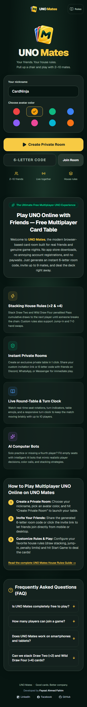 | 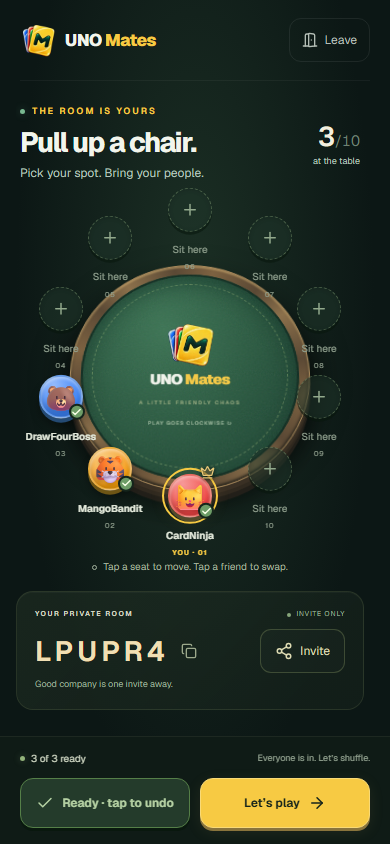 |

| Play with your mates | A place for everyone |
| --- | --- |
| 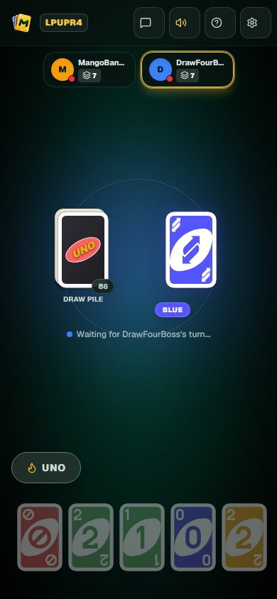 | 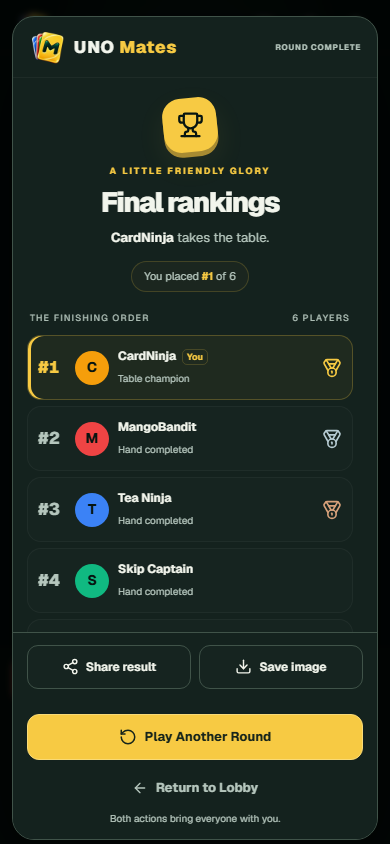 |

<details>
<summary>Every page on mobile</summary>

| Rules | Settings |
| --- | --- |
| 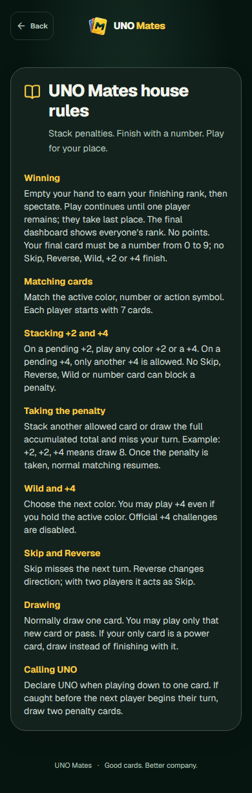 | 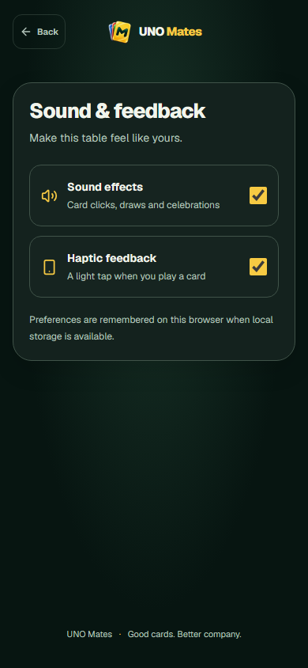 |

| Create a room | Join your mates |
| --- | --- |
| 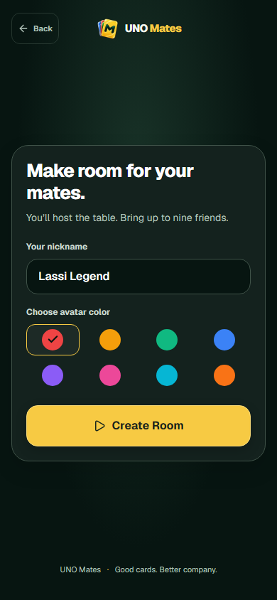 | 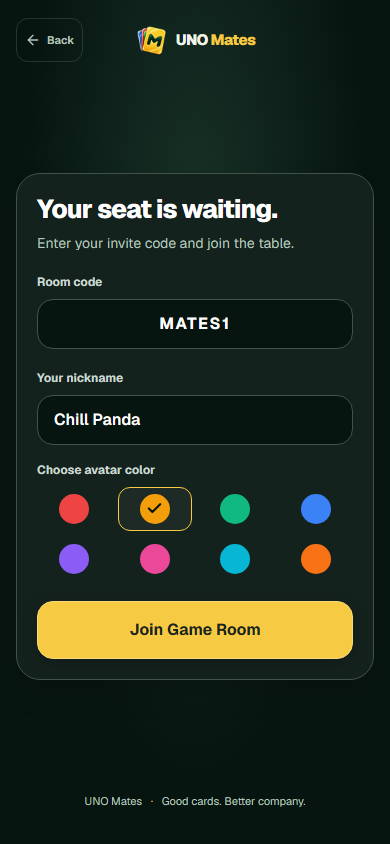 |

| Room chat | Sound and feedback |
| --- | --- |
| 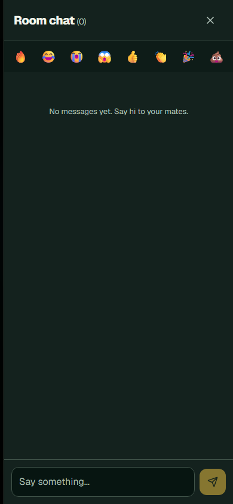 | 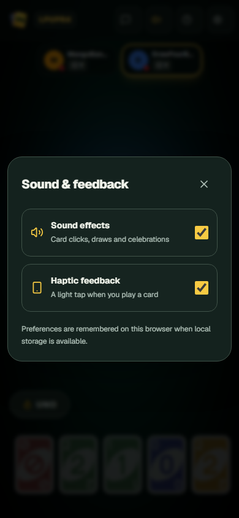 |

</details>

<details>
<summary>Every page on desktop</summary>

| Home | Create room |
| --- | --- |
| 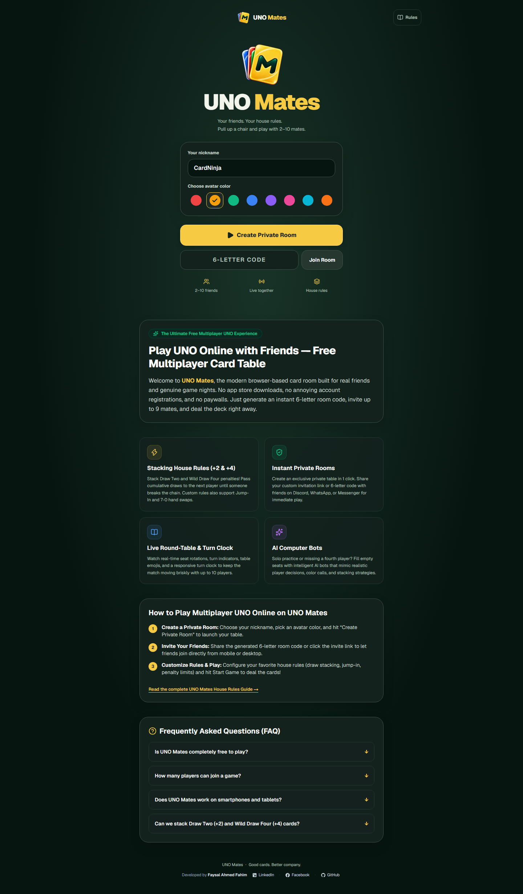 | 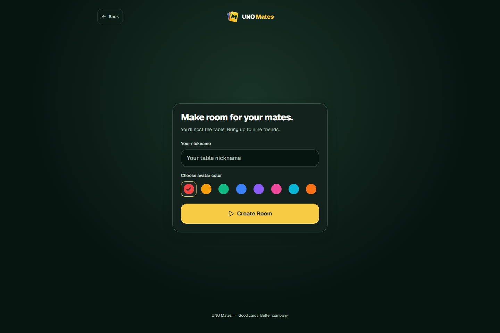 |

| Join room | Lobby |
| --- | --- |
| 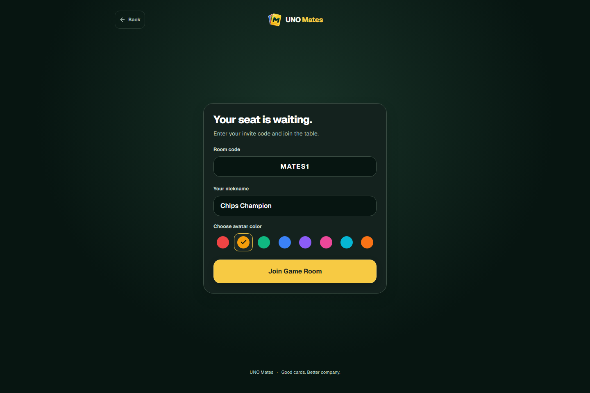 | 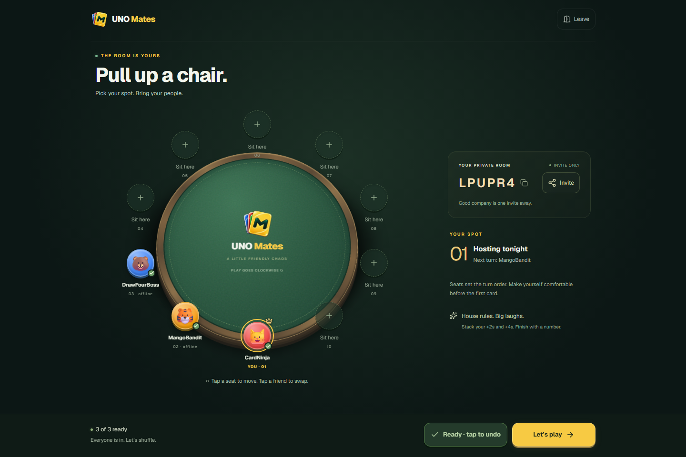 |

| Gameplay | Final rankings |
| --- | --- |
| 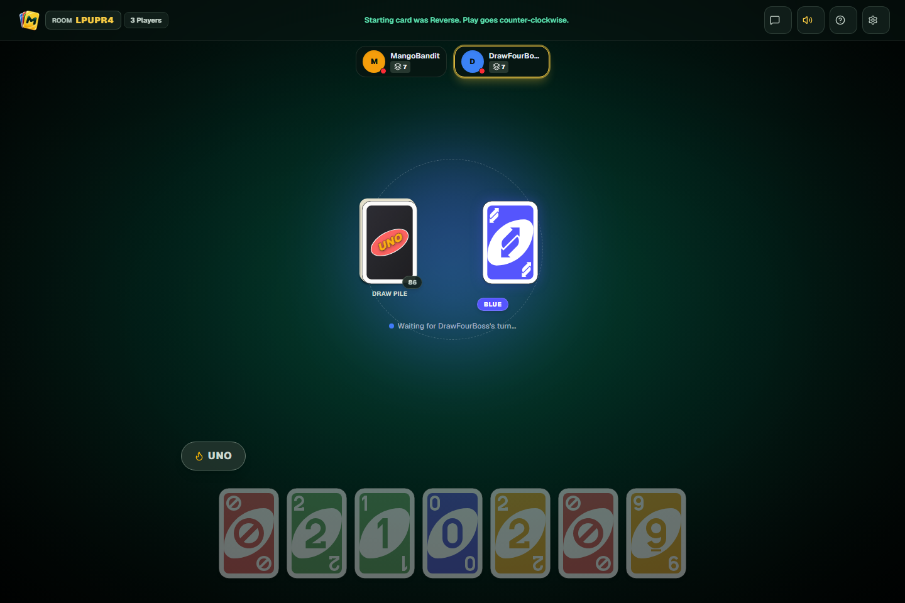 | 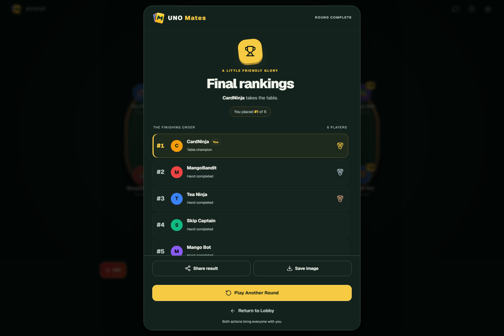 |

| Rules | Settings |
| --- | --- |
| 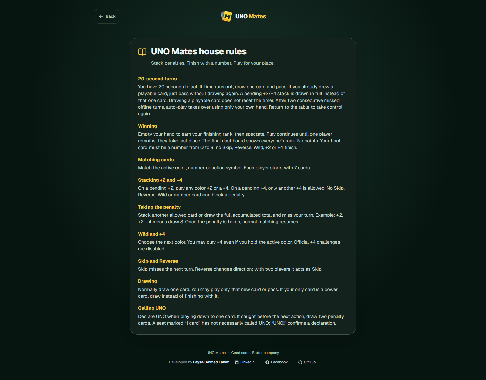 | 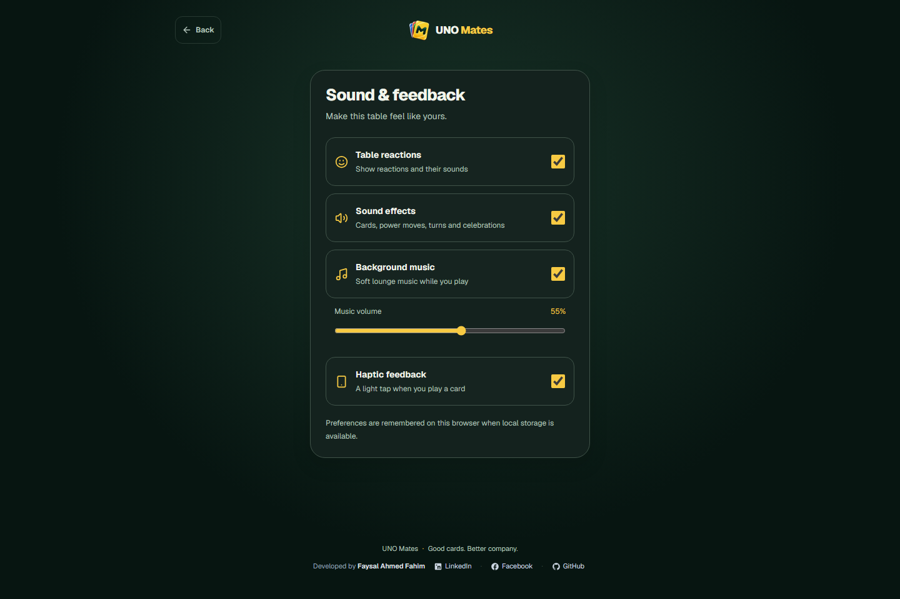 |

| Table talk | Share your result |
| --- | --- |
| 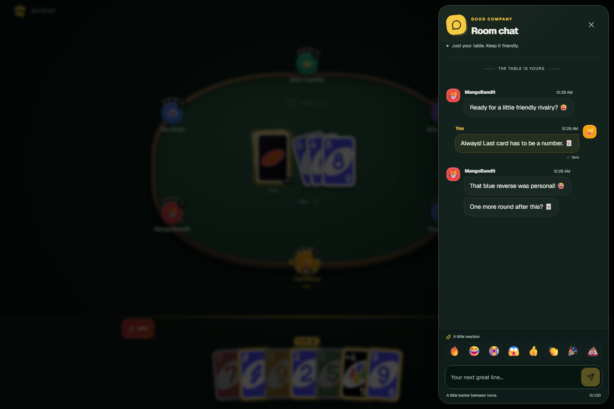 | 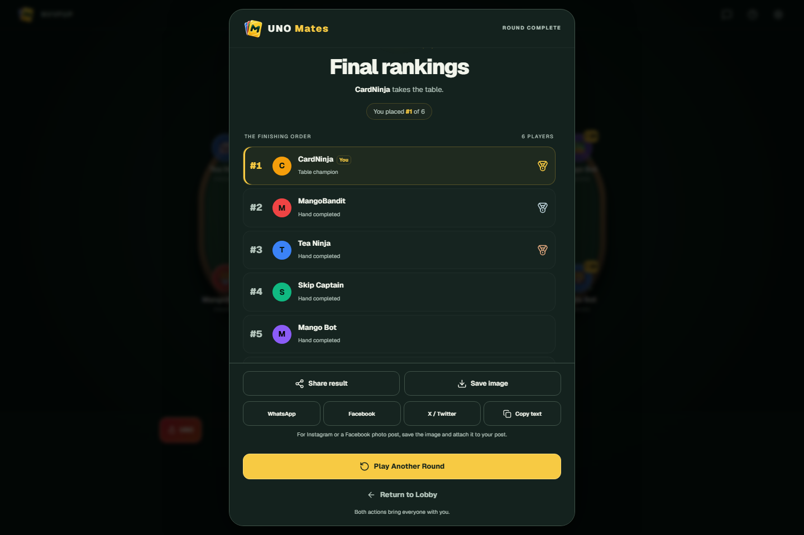 |

</details>

## Made for a game night

- **A room, not an account.** Choose a nickname and avatar, create a private room, then share its six-character invitation code.
- **Choose your seat.** Ten seats around a raised felt table. Move to an empty seat or swap with a mate before the game starts. Change your own nickname in the lobby; hosts can confirm removal of another player, including an offline seat. Removal frees the seat and allows a fresh join; it is not a permanent ban.
- **Play together in real time.** Private Supabase Broadcast channels carry committed moves and chat; Presence shows who is connected. Game and chat state are not polled.
- **A little table talk.** Character avatars, grouped messages and quick emoji reactions in a phone-friendly chat sheet. New messages briefly appear above your hand, then shrink into the chat icon. Unread messages stay marked until you open chat; reduced motion uses a fade.
- **Play solo or with friends.** Hosts can add ready computer seats in the lobby, up to ten total players. Bots choose moves from their own hand/public state, call UNO, catch missed UNO, and stay after restart/return-to-lobby. Offline human takeovers still return control when the person reconnects.
- **Twenty-second turns.** A server worker draws a timeout card when needed, passes expired turns, takes stacked penalties in full, and takes over after two consecutive offline misses. The bot uses only its own cards; returning restores human control. Drawing a playable card does not restart the timer.
- **Empty tables close.** If no human is connected, the worker stops card play and confirms the empty table for 15 seconds. A quick return resumes the original deadline. Otherwise the match and room close permanently, with no background bot play or invented final rankings. Bot seats do not keep a table alive; returning players see a closed-table screen and can create a fresh room.
- **Reactions at your seat.** Four short reactions have distinct sounds, a two-second send limit and an optional mute. At most three appear at once, away from the cards. Rule hints explain stacking and warn before leaving a power card as your final card; “1 card” and a declared “UNO!” are different states.
- **Cards with a little weight.** Shuffle, deal one card per player across seven passes, play from the right seat, and draw from the deck. The last two played cards remain visible behind the top discard.
- **A real table feel.** Play around a walnut-edged felt table, with every mate in a fixed seat and your own hand below. Tap a seat for player details; larger hands scroll without crowding the board.
- **Know when to move.** Your avatar pulses with a moving gold pointer, while a PLAY/DRAW cue points toward your next action. Visible playable cards lift once when a new turn starts. Other players keep a steady turn pointer; reduced motion uses static highlights.
- **Fast feedback, checked moves.** Your legal play appears immediately. The server validates it; rejected moves restore the confirmed table and show an error. Hidden draw cards are never guessed.
- **Keep playing for your place.** Finishing first earns first place. The others continue until one player remains, followed by a complete ranking table.
- **Small-screen care.** Touch targets, readable card colors, labelled controls, keyboard-friendly dialogs and reduced-motion behavior. Sound preferences are remembered locally; supported devices can use haptic feedback.
- **A table you can hear.** Original synthesized paper swishes, shuffle/deal sounds, distinct power-card cues, UNO/Catch, turn chimes, chat, lobby changes and finish fanfares, with a quiet lounge music loop. Music has its own switch and saved volume slider. Audio needs an initial tap, respects mute, and stops when the tab is hidden. No audio downloads.

## Our house rules

This is a custom game for friends, not an implementation of every official UNO rule.

| Situation | What happens |
| --- | --- |
| Starting hand | Everyone receives seven cards. |
| Turn time | 20 seconds. A missed turn draws one card and passes, or just passes if you already drew. A pending +2/+4 stack is drawn in full instead. |
| Offline turns | Two consecutive offline missed turns enable auto-play. Returning restores control; online missed turns do not count toward this threshold. |
| A normal play | Match the active color, number or action symbol. Wild cards choose the next color. |
| A pending +2 | Stack any color +2 or a +4. |
| A pending +4 | Only another +4 can stack. |
| Accepting a stack | Draw the accumulated total and miss your turn. A +2, +2, +4 stack means draw eight. |
| Wild Draw Four | It can be played even while holding the active color. Official +4 challenges are disabled. |
| Skip / Reverse | Skip the next active player / reverse direction. With two active players, Reverse acts as Skip. Finished players are passed over. |
| Drawing normally | Draw one. If it is playable, play that card or pass; otherwise the turn advances. |
| Calling UNO | Call when going down to one card. A mate can catch a missed call before the next action and make you draw two. |
| Finishing | Your final card must be a number, 0–9. You cannot finish with Skip, Reverse, Wild, +2 or +4. |
| Rankings | Empty hands receive consecutive places and spectate. The last remaining player receives last place. There are no points. |

The rules page and in-game help use the same copy, and both client previews and server validation share the same TypeScript engine.

## Built with

**Next.js 16 · React 19 · TypeScript · Tailwind CSS 4 · Motion · Supabase PostgreSQL & Realtime · Zustand · Lucide · Zod · Vitest · Playwright**

The game uses a 108-card deck and local SVG card artwork. Branding uses the original UNO Mates card-fan M mark, with matching browser and Apple icons.

## Run it locally

Use a current Node.js LTS release compatible with the installed Next.js version.

~~~bash
git clone https://github.com/0xFaysal/UNO-Mates.git
cd UNO-Mates
npm ci
~~~

Copy [.env.example](.env.example) to .env.local and configure your Supabase project:

~~~dotenv
NEXT_PUBLIC_SUPABASE_URL=https://your-project.supabase.co
NEXT_PUBLIC_SUPABASE_PUBLISHABLE_KEY=your-publishable-key
SUPABASE_SERVICE_ROLE_KEY=your-server-only-service-role-key
NEXT_PUBLIC_SITE_URL=http://localhost:3000
~~~

Set only one public key. For a legacy anon key, remove the publishable-key placeholder and set NEXT_PUBLIC_SUPABASE_ANON_KEY instead. The server accepts SUPABASE_SECRET_KEY as an alternative to SUPABASE_SERVICE_ROLE_KEY. Keep server keys out of public variables and source control.

### Database setup

Run these SQL files in the Supabase SQL editor, in order:

1. [Initial schema](supabase/migrations/001_initial_schema.sql)
2. [Private realtime channels and triggers](supabase/realtime.sql)
3. [Round-table seating and room operations](supabase/seating.sql)
4. [Room-scoped guest sessions](supabase/room-sessions.sql)
5. [Game context lookup and compact broadcasts](supabase/game-fast-path.sql)
6. [Lobby renaming, host removal and member-only chat delivery](supabase/lobby-management.sql)
7. [Completed-round return to lobby](supabase/round-lifecycle.sql)
8. Deploy `supabase/functions/uno-clock` as described below, then apply [turn clock and reactions](supabase/turn-clock-and-reactions.sql).
9. [Chat player-reference index](supabase/migrations/002_chat_player_index.sql).
10. [Computer players and reactive UNO bots](supabase/migrations/003_computer_players.sql).
11. [Human-only private broadcasts](supabase/migrations/004_bot_broadcasts.sql).
12. [Atomic closure of abandoned matches](supabase/migrations/20261031184241_close_abandoned_matches.sql), then regenerate/redeploy `uno-clock`.

These configure the tables, access policies and server-only operations. A real Supabase project is required for browser multiplayer; the in-memory fallback supports engine tests and development utilities.

### Server turn clock

Run `node scripts/package-turn-worker.mjs --write` before deploying the `uno-clock` Edge Function. This generates its local `game/` imports from the shared TypeScript rules engine; regenerate and redeploy it whenever those rules change. The generated copies are ignored by Git. Edge Functions use the Deno runtime and are excluded from the Next.js TypeScript project.

Deploy with gateway JWT verification disabled: the function independently requires a 64-character private Vault token, checked through a service-only RPC. Never remove that check. Supabase supplies the function's service credentials internally. In `turn-clock-and-reactions.sql`, replace the `uno_clock_url` project hostname when installing on a different project. The migration generates the token inside Vault without printing it and schedules an indexed due-turn dispatcher every second. It invokes the worker only when turns are due, claims bounded batches and does not broadcast claim bookkeeping. No open browser or Vercel background process is required. Actions arriving after the deadline are rejected; visible turn transitions follow server confirmation and network latency.

The first turn has a separate opening-readiness phase. The authenticated first player's client acknowledges only after shuffle, dealing and the opening flip have finished; the server then starts a full twenty seconds. Other players, stale rounds, duplicate acknowledgements and refreshes cannot restart that deadline. A fixed opening grace lets a connected slow phone finish; the worker starts a normal twenty-second fallback if no acknowledgement arrives, rather than blocking the room indefinitely. Preparing/dealing time is hidden from the playable countdown. During play, the central timer panel and draining active-avatar ring share the same server deadline; the final five seconds use a warm warning color and one local sound.

The worker reads room Presence before classifying a missed turn as offline. An uncertain presence result is retried rather than counted as an offline miss. The second offline miss still resolves the timeout and passes that turn; auto-play starts on the player's subsequent turns. A missed turn costs one card only if no normal card was already drawn; stacked penalties replace this one-card cost. Reactions use a server-only, rate-limited RPC and current members' private channels, with no stored reaction history.

~~~bash
npm run dev
~~~

Open [localhost:3000](http://localhost:3000). The project uses the Webpack path for its current Next.js and Tailwind setup.

## Test on a phone with production performance

Development mode compiles routes and retains compiler/debugging data. For realistic memory, loading speed and phone tests, stop the development server and run:

```sh
npm run build
npm run preview
```

Open the Network URL printed by Next.js from a phone on the same Wi-Fi. `preview` explicitly enables HTTP cookies for a trusted local network; it refuses to run on Vercel. Normal `npm run start` keeps HTTPS-only production cookies. `npm run dev` is for editing with hot reload; it can use much more RAM than the production server. See [PERFORMANCE.md](PERFORMANCE.md) for measured results, optimizations and the slow-network test.

## Deploy to Vercel

1. Import this repository into Vercel.
2. Add the Supabase URL, public key and server-only key to the project's environment variables.
3. Set NEXT_PUBLIC_SITE_URL to your production website origin for social previews. Invitation links use the current browser origin.
4. Run the database setup above, then deploy.
5. Test with two independent browser sessions: create → join → ready → start → play → refresh.

[vercel.json](vercel.json) currently selects Dublin (dub1) to match this project's Supabase region. Change that region if your own database runs elsewhere. No persistent WebSocket server is hosted by the Next.js app; Supabase handles live channels. Check your providers' current plan limits before choosing a production plan.

## How a move travels

~~~mermaid
flowchart LR
  A[Player action] --> B[Immediate local preview]
  A --> C[Next.js API]
  C --> D[Validate membership and game rules]
  D --> E[Save with a version check]
  E --> F[Private database Broadcast]
  F --> G[Each player gets their own hand]
  G --> B
~~~

- An HttpOnly guest cookie authorizes room actions. A room-scoped Auth identity grants access to only that room and player's private channels.
- The server keeps the draw order and every player's hand. Each client receives its own hand and sanitized public state.
- Version checks prevent stale actions from overwriting a newer move. Request IDs prevent a local preview and its confirmed event from animating twice.
- Reconnection takes a fresh snapshot. An expired room session returns to the join form.
- Sound, haptic and message-preview preferences persist locally; selected cards, open dialogs and round data do not. Message previews default on; disabling them keeps chat history and unread badges available. Exiting through game settings, the header logo or results requires confirmation, with Keep playing focused first.
- Hourly database retention (`uno-data-cleanup`, minute 43 UTC) removes inactive completed/closed tables after 24 hours and unused lobbies after 7 days. Room deletion cascades to memberships, hands/deck, chat, events and reaction limits. Playing states are excluded; recent chat, membership activity and guest sign-in protect a room. Only generated, unlinked guest identities inactive for 7 days are eligible for Auth cleanup; Storage owners are retained. Each run is capped at 100 rooms and 200 guests, with room/game locks and a transaction advisory lock. Preferences in the browser are unaffected.

Game writes from the API and worker timestamp activity in a database trigger; scheduler lease updates do not extend retention. Existing results receive a fresh 24-hour grace period when this policy is installed, since older versions did not timestamp every move.

The database regression script at `supabase/tests/data-retention.sql` runs as the database owner after both retention migrations. It exercises expiration, active-game/reconnect protection, cascading deletes, guest scope, restricted permissions, activity timestamps and repeated execution inside a transaction, then rolls back all fixtures and deletions.

## Quality checks

~~~bash
npm run lint
npm run typecheck
npm test
npm run test:e2e
npm run build
~~~

Install Playwright's Chromium browser if needed with npx playwright install chromium. Browser tests require the configured Supabase environment and create isolated test rooms; use a development Supabase project when running the suite repeatedly.

The browser suite covers multiplayer privacy, idle traffic without polling, seat swaps, ten-player dealing, optimistic move rollback, all-player rankings, reconnects, blocked browser storage, remembered preferences, dialog focus and failed chat recovery. Engagement checks exercise the real scheduled worker with no browser open, full stacked penalties, offline takeover, online idle turns, reconnect recovery, hints, reaction privacy/mute and phone layouts. Sound checks render all 35 cues through Web Audio to check audible output, headroom and silent tails, and verify touch/keyboard unlock and persistent mute. A local listening sampler is written to `artifacts/sounds/` by the sound browser test.

To refresh the screenshots and DOM inspection used by the UI audit, run:

~~~bash
node scripts/capture-ui.mjs final
~~~

See [the UI audit](docs/UI-AUDIT.md) for the scope, findings, fixes and verification limits.

## Project map

~~~text
src/app/                 Routes, API handlers and metadata
src/components/brand/    Shared logo and public navigation
src/components/game/     Table, cards, motion, dialogs and rankings
src/components/ui/       Profile controls and native dialog behavior
src/lib/game/            Rules, deck, prediction and tests
src/lib/client/          Realtime, preferences and feedback
src/lib/server/          Sessions and authoritative persistence
supabase/                Schema, policies and server-only database helpers
e2e/                     Multiplayer and browser interaction checks
docs/                    Screenshots and UI audit evidence
~~~

## Contributing

Contributions, bug reports, and suggestions are warmly welcomed! Please read [CONTRIBUTING.md](CONTRIBUTING.md) to get started and review our [Code of Conduct](CODE_OF_CONDUCT.md).

If you discover a security vulnerability, please consult our [Security Policy](SECURITY.md).

## License

This project is licensed under the [MIT License](LICENSE).

## Developer

Developed by **Faysal Ahmed Fahim**

- **Email**: [faysalfahim03@gmail.com](mailto:faysalfahim03@gmail.com)
- **LinkedIn**: [faysal-ahmed-fahim01](https://bd.linkedin.com/in/faysal-ahmed-fahim01)
- **Facebook**: [FaysalAhmedFAHlM](https://www.facebook.com/FaysalAhmedFAHlM/)
- **GitHub**: [@0xFaysal](https://github.com/0xFaysal)

UNO Mates is an independent fan-made project and is not affiliated with or endorsed by Mattel. The UNO name and existing game card artwork are separate from the original UNO Mates website mark.

